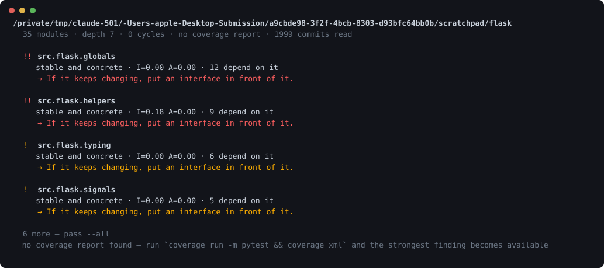

# codebase-mapper

[](https://github.com/KRISH123no/codebase-mapper/actions/workflows/ci.yml)



**What is load-bearing in this codebase, and what is untested.**

You join a project with four hundred files and no idea which ones matter. Every developer hits this,
every new job, every open-source contribution — and interns hit it in week one. The existing answer
is a dependency diagram, which is impressive once and never opened again.

This does not draw a diagram. It tells you the three or four things that are actually wrong, worst
first.

```bash
pip install -e ".[dev]"
codebase-mapper .                   # the findings
codebase-mapper numbers .           # the metrics, to argue with the ranking
```

No dependencies. `ast`, `xml` and `git` are all it needs, and it never executes the code it reads.

## The finding that makes it worth running

Coverage tools say *"68% covered"*, which tells you nothing about whether the covered 68% is the part
that matters. A dependency graph says *"nine modules depend on this"*, which tells you nothing about
whether that is a risk.

**Together they say something neither says alone:**

```
  !! storage
     9 modules depend on it · 14% covered
     → Test this before anything else in the project.
```

That is the whole idea. Neither number is new; the overlay is.

## Three findings, ranked by blast radius

**Load-bearing and untested** — the above. Severity scales with both how many modules a bug could
reach *and* what share of the project that is, because nine of ten is worse than nine of three
hundred, and "everything depends on it" means something different in a small project.

**Cycles**, with the cheapest edge to cut — the one leaving the most unstable module, since that end
is already free to change.

**Hidden coupling**, from git. Two files that change together in four commits out of five, with no
import between them, are coupled through something the source does not say: a shared schema, a
duplicated constant, a protocol both ends implement. **An import graph structurally cannot see this**,
and it is where the surprises in an unfamiliar codebase live.

## The metrics are thirty years old

Robert Martin's package metrics, which are formal and computable:

| | |
|---|---|
| **Ca** | how many modules depend on this one |
| **Ce** | how many it depends on |
| **I** | instability, `Ce/(Ca+Ce)` — 0 means nothing can force it to change |
| **A** | abstractness — the share of its classes that are abstract |
| **D** | `\|A+I-1\|` — distance from the balance between the two |

A module should be either **stable and abstract** — safe for everything to lean on, because you
extend it rather than edit it — or **unstable and concrete**, free to change because nothing depends
on it. Stable *and* concrete is the painful corner.

**But a types module is exactly that shape and is usually fine**, so coverage lowers the severity
rather than deciding the finding. Running this on a sister project, a dataclasses module dropped from
severity 15 to 3 once its 89% coverage was read. Pain you have tested is survivable.

## What it will not claim

Half of what gets called "software engineering principles" was never formal. You cannot compile
*single responsibility* into a check, because a responsibility is not a measurable quantity, and a
tool that reports "SRP violation" is guessing with confidence.

So where a check is a proxy, the output says so:

```
  !  sessions
     depends on 12 modules
     → Worth a look — this is a proxy, not a verdict.
```

It will tell you, as fact, that there is a cycle, that nine things depend on an untested module, and
that two files always change together. It will not tell you whether your architecture suits your
business, whether this should have been two services, or whether the design is good. Those are
judgements about a domain no analyser understands.

**And no AI.** Same input, same output, no model calls, works offline. The only place a model could
go is turning English into a structure at the input boundary, and cutting that was what made the
rest deterministic.

## Three bugs the real world found

Pointed at `requests`, it reported an **eleven-module cycle** — half the project. That smelled wrong,
and it was: `from . import sessions` was recording an edge to the *package* rather than to
`requests.sessions`, which gave every submodule a phantom edge back to `__init__`. A package that
re-exports its contents then looks like one enormous cycle. Resolving each import to the most
specific module that exists dropped it to a real cycle of 8.

The severity of "load-bearing and untested" was a **share** of the project, so a module every other
module depended on scored identically in a 3-module project and a 30-module one. Now it weighs the
count as well as the share.

Then Flask came out as a **twenty-module cycle** out of thirty-five. Also wrong, and the most
important of the three. `ast.walk` flattens the tree, so

```python
if TYPE_CHECKING:
    from .app import Flask
```

counted exactly like a module-level import. It is not one — nothing is imported at run time, and
the author wrote it that way *because* there is a cycle. The tool was reporting the workaround as
the problem. Imports inside functions and under `TYPE_CHECKING` are now tracked separately, and
Flask, requests and black all show **zero runtime cycles**, which is the right answer for three
mature libraries that each solved this deliberately.

## What "works" means

Acceptance criteria, how each is checked, and what is deliberately out of scope:
**[docs/ACCEPTANCE.md](docs/ACCEPTANCE.md)**. Written after the fact, which the document says.

Measured: Django, 920 modules across 2,933 files, **9.7 seconds**.

## What the tests check

```bash
pytest -q      # 113 tests, under a second
ruff check .
```

Parsing is tested against small projects written to disk, because the relative-import rules are the
whole difficulty — `from .b import x`, `from . import b`, `from ..shared import x`, and the
difference between a package and a module inside one. Everything after parsing is arithmetic over
dataclasses, so it runs anywhere.

## Limits

- **Python only.** `ast` ships with Python and cannot execute what it reads. Other languages mean
  `tree-sitter` and a parser each.
- **It sees what the source says.** Imports built from strings, plugin registries, dependency
  injection and anything resolved at runtime are invisible. The graph is a floor, not the truth.
- **Deferred imports are tracked but not reported.** An import inside a function or under
  `TYPE_CHECKING` is a real relationship and not a runtime dependency, so it is kept out of the
  cycle check. Surfacing it as "these modules are conceptually coupled, and someone already worked
  around it" would be useful and is not written yet.
- **Abstractness is approximated** by counting classes that inherit `ABC` or `Protocol`, or hold an
  `@abstractmethod`. Duck typing is abstract in practice and concrete here.
- **No coverage report, no headline finding.** It says so and prints the command to produce one.
- **Co-change needs history.** On a repository with four commits there is nothing to find.

## Layout

| File | Lines | Role |
|---|---:|---|
| `findings.py` | 206 | what is worth saying, and in what order |
| `parse.py` | 238 | Python into modules and edges |
| `graph.py` | 180 | coupling, instability, cycles, depth |
| `history.py` | 124 | what changes together |
| `cli.py` | 122 | the command |
| `report.py` | 98 | printing it |
| `coverage.py` | 108 | matching a report to modules |
| `model.py` | 64 | the three types |

1,149 lines of implementation, 902 of tests.

## Licence

MIT.
